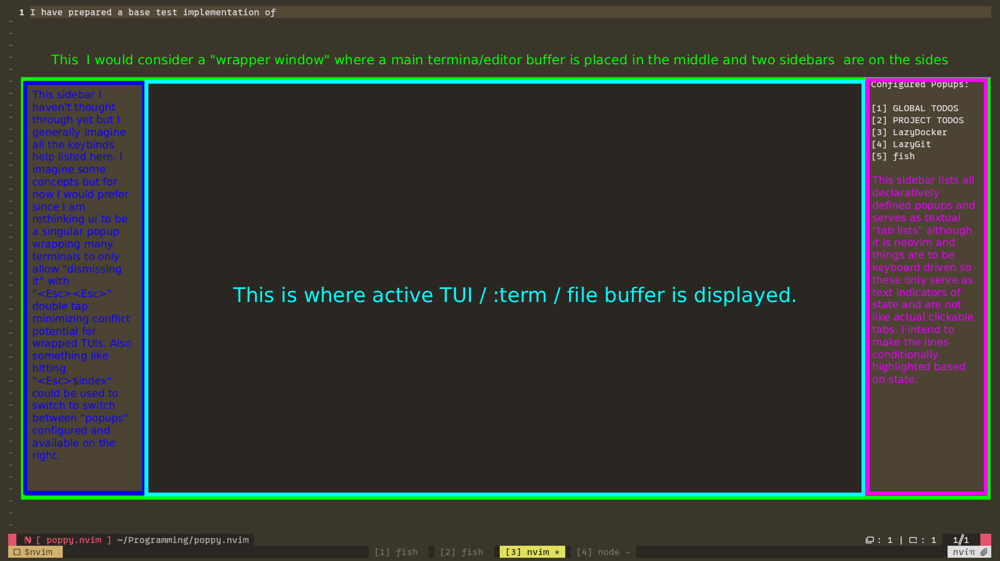
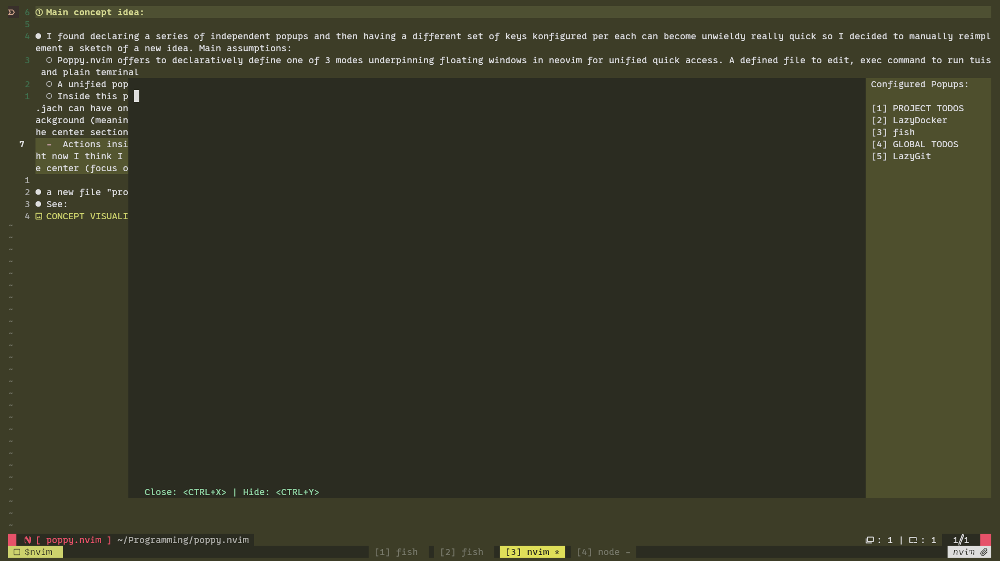

# Main concept idea:

- I found declaring a series of independent popups and then having a different set of keys konfigured per each can become unwieldy really quick so I decided to manually reimplement a sketch of a new idea. Main assumptions:
  - Poppy.nvim offers to declaratively define one of 3 modes underpinning floating windows in neovim for unified quick access. A defined file to edit, exec command to run tuis and plain temrinal
  - A unified popup is displayed that can be brought up with a user command and users can define their own single keybind.
  - Inside this popup we have a "vertical-tab-list style" sidebar (just text dynamically colored using extmarks that serves as kinda tui equivalent of browser's vertical tabs).jach can have one of 3 states, not active and non background (meaning no buffer nor window opened for file/terminal, or tui app is not a running process), active and in the background (meaning window is hidden, buffer is in memory and preserves state like non-saved changes and cursor position etc) and one is active meaning currently displayed in the center section of the popup.
  - Actions inside the poppy popup are controlled via a "prefix mode" for now I haven't decided what the good default binds be to not conflict with neovim or running tui. Right now I think I assume "work-in-progress" "<Esc>" prefix like "<Esc><Esc>" would dismiss poppy ui, "<Esc>" .. index would switch to a popup making it active and visible in the center (focus or open action) or "<Esc>k" to kill tab. Potential other binds to be explored or a different approach if this does not work.

- a new file "prototyping.lua" has been added to create a POC test implementation. It is not itegral, just my experimenting to see how it would come together.
- See:
  
   // NOTE: The attempt to color with extmarks failed. I am just trying to learn how to use them.

- I have other ideas but this seems like a basic minimum to achieve let's say an "alpha software" state.
- One last small thing to note. Current impl calls independent windows "popups". Since I plan to provide one interface wrapping all of those in one "popup wrapper window" I was thinking I could lean into the name I came up with and I like and name these "sub-windows" "poppies" as an abstraction and cool "brand consistency" thingy. Still considering. Thoughts?
