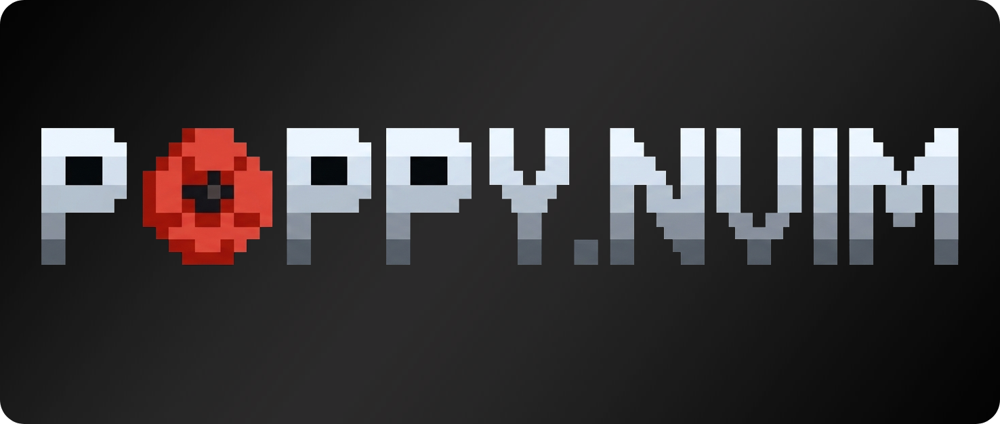

# poppy.nvim

<br> 



<br> 

A neovim popup scratchpad manager. Simple setup, as natural feel as possible and internal custom box of mechanisms that suit the custom made workflow.

## Screenshots:

\<-- TODO: Add Screenshots -->

## Inspiration, motivation and other human-brain-made-slop

A bit of an extended personal introduction:

In my personal config I had for a long time some circular bindings to access important floating ui windows super-quickly. I.E:

```lua

--[[ Repeatedly cycle display > enter > close lsp hovers with just K,
not having to jump to q or do <C-w> ]]--

vim.keymap.set("n", "<S-K>", function()
    if vim.w.lsp_floating_bufnr ~= nil or vim.w["textDocument/hover"] ~= nil then
        vim.cmd("quit")
        return
    end
    vim.lsp.buf.hover()
end, { silent = true, noremap = true })


-- Same idea but for lsp diagnostic floats

vim.keymap.set("n", "<S-L>", function()
    if vim.w.diag_float then
        vim.api.nvim_win_close(0, true)
        return
    end
    local _, win = vim.diagnostic.open_float({ focusable = true })
    if win then
        vim.api.nvim_win_set_var(win, "diag_float", true)
        return
    end
    -- dumb fallback perform a motion move
    if not vim.w.diag_float then
        vim.cmd("normal! " .. (vim.v.count > 0 and vim.v.count or 2) .. "l")
    end
end, { noremap = true, silent = true })

```

This is the first of the 3 sources of inspiration for the one bind-to-rule-them-all scratchpad manager.

Another significant inspiration was [SUMMON.NVIM](https://github.com/salkhalil/summon.nvim) by salhalin that briefly lived then apparently died, but I liked the idea of declaratively setting just a couple tools OR files to access in a simple unified form. What I did not like in this and practically all other plugins is you have to declare a binding for each "thingy" you setup and then remember all your bindings, or worse, find confortable binds that are still AVAILABLE in your config.

Third large inspiration were [ oil.nvim ](https://github.com/stevearc/oil.nvim/issues) and [ mini.files ](https://github.com/nvim-mini/mini.files) for just using a buffer navigated with `j/k` as sort of a picker and perform actions with simple binds acting on a *LINE*. I find it so elegant, simple and native. No mental switching buffer navigation paradigm to another. Even to "native" `<C-n> and <C-p>`, square brackets and so on I find so clunky and ununified that to every supporter of "just use defaults" I want to reply "are the defaults good? If I can't do `hjkl` in vim then it is a failure of navigation design.

You can tell by now probably that the plugin is a bit opinioneted and its design is arguably a result of a bit of overthinking. However, all this is aiming to make it FEEL simple. Scratchpads are a concept that is meant to be simple and quick. If I want a heavily configured TUI swiss army knife / tank tool to do serious extended work I will just open another terminal/multiplexer pane.

Last bonus "anti-inspiration" was [toggleterm.nvim](https://github.com/akinsho/toggleterm.nvim) it is an old and good project but, oh how I hated it. Custom Api, super-fine-grained control. Hook for every single one of 50 opts and you can or redefine all of them per "Terminal" object. I used it back when I started neovim when `lunar` was a thing, `astrovim` was still a new project and nvchad wasn't even in the field yet, I believe. It is a powerful tool, but one might say it is heavily overengineered for a plugin managing transient terminal spawns.

Poppy needs as little opts as possible? What to open and how. Defaults to to shipped icons and even title has a fallback detection so you do not even need to name your poppy.

Speaking on this sidebar selector. You might be asking:

> Why not just use pickers or vim.ui.select?

Well the API surface is provided. For pickers there are like 5 options minimum at any time plus new custom vibecoded solutions. Wire your own if you want to telescope your poppies, I am not supporting every user scenario under the sun especially that personal code generation became so cheap and easy with AI these days.

If you read this, I salute you. Now back to the (mostly) automated transmission.

## AI Disclosure

\<-- TODO: Add Disclosure -->

## Installation

```lua
-- Neovim 0.12+ (built-in vim.pack)
vim.pack.add({ "https://git.tomgora.online/tomeczku/poppy.nvim" })
require("poppy").setup({
    poppies = {
        -- declaring some poppy entries is required for the plugin to work
        -- poppy doesn't ship anything default here that might go in conflict
        -- with the system environment or unintentionally litter files on the fs

        lazygit = { exec = "lazygit",  title = "LazyGit" },
        todos   = { file = "~/Documents/TODO.md", title = "Todos" },
        scratch = { shell = "default", title = "Terminal" },
    },
})

-- lazy.nvim
{
    "https://git.tomgora.online/tomeczku/poppy.nvim",
    lazy = false,
    priority = 1000,
    opts = {
        poppies = {
            lazygit = { exec = "lazygit",  title = "LazyGit" },
            todos   = { file = "~/Documents/TODO.md", title = "Todos" },
            scratch = { shell = "~/.local/opt/bash-5.2/bin/bash", title = "Bash 5.2" },
        },
    },
},
```

## Configuration

```lua
-- defaults:
require("poppy").setup({
    keys = {
        poppy_action = "<C-/>",  -- remap if it doesn't work in your terminal or just have a different idea
        select       = "l",
        kill         = "d",
        exit_menu    = "h",
    },
    icons                      = { exec = "🛠", shell = "$", file = "🗋" }, -- unicode as safer defaults, can be nerdfont glyphs
    autohide_menu              = false,     -- hide sidebar after selecting or after inactivity timeout
    title_header               = true,      -- show or hide decorative chome
    hints_footer               = true,      -- show or hide informative chome
    close_on_focus_lost        = true,      -- close when focus leaves poppy
                                            -- (cmdline, loclist, quickfix, preview, and nofile popups 
                                            -- such as hovers and diagnostic floats ignored)
    close_other_floats_on_open = true,      -- close other floating windows when poppy opens (notifications skipped)
    assume_multiplexer         = false,     -- set true inside tmux/screen when <C-/> never reaches nvim
    border                     = "rounded", -- "none" | "single" | "double" | "rounded" | "shadow" | border spec
    menu_width                 = 25,
    win_height                 = 0.75,      -- ratio (0.2..1.0), absolute cells (>1), or function
    win_width                  = 0.8,
    win_location               = "center",  -- "center" | "top" | "bottom"
                                            -- Horiontally always in the middle, choose if you prefer to stick to top, bottom or remain default centered depending on what region your neck finds easier to target your eyeballs at.

    poppies = {
        -- minimal example, not defaults.
        -- You have to declare your own
        lazygit = { exec = "lazygit" },
        todos   = { file = "~/Documents/TODO.md" },
        scratch = { shell = "default" },
    },
})
```

### Poppy modes

| Key | Type | Behavior |
| --- | --- | --- |
| `exec` | `string\|string[]\|function` | Spawns a terminal buffer running the command. Command must be on `$PATH`. |
| `file` | `string\|function` | Opens the file at the given path. If the path does not exist when opening, a dialog asks whether to create it (and its parent directories) or drop that poppy and not use it nor display it in that session. |
| `shell` | `string\|function` | Spawns a terminal buffer with the shell. Set to `"default"` to use `$SHELL` value from the environment. |

`exec`/`file`/`shell` are validated at setup. A poppy with none is dropped; with more than one, the first (`exec`, then `file`, then `shell`) wins and poppy warns. `title` is optional and defaults to the file basename or command name.

### Borders

`border` takes `"none"`, `"single"`, `"double"`, `"rounded"`, `"shadow"`, or a border table of chars. `"none"` (and `"solid"`) use poppy's borderless design. If `border` is not set — the default — poppy falls back to `vim.opt.winborder`; if that is empty or invalid, it uses borderless.

### Key bindings

`keys.poppy_action` is the one binding you press constantly, so it deserves a moment of attention. Inside tmux or screen, some terminals drop `<C-/>` (or any Ctrl combination whose underlying byte is consumed by the multiplexer) before it reaches nvim — the keymap is bound but never fires. If that happens to you, either:

- bind a key your terminal forwards cleanly (`<C-_>`, `<C-\>`, etc.), or
- set `assume_multiplexer = true` and poppy will rebind `<C-/>` to `<C-_>` automatically when `$TMUX`/`$STY` are set.

On modern terminals (kitty, wezterm, foot with `extkeys`, ghostty) inside tmux, `<C-/>` usually works as-is — `assume_multiplexer` is only needed when it doesn't.

### Dialogs

Two questions can interrupt an open. Both are answered before the UI settles, and several missing files are resolved one after another:

- **Missing file** — a `file` poppy points at a path that does not exist. `Yes` creates it along with its parent directories, `No` drops that poppy and it is not available from menu.
- **Unsaved changes** — you kill a poppy whose buffer is modified. `Save` writes it, `Discard` drops the changes, `Go back` cancels the kill. Terminals are exempt: their `modified` flag never flips.

### Unsaved edits and missing files

Buffers stay loaded between switches (`bufhidden = "hide"`). On re-open: a clean buffer is re-read from disk; a modified buffer is reattached untouched; a vanished file keeps its contents and `:write` recreates it. If a `file` function resolves to a new path, the old buffer is discarded.

## Usage

`keys.poppy_action` opens the manager; press it again to close. From the sidebar: `select` switches the content pane, `kill` removes a poppy, `exit_menu` returns focus to the content pane.

```
:Poppy                 " toggle
:Poppy close           " close
:Poppy menu            " toggle the sidebar only
:Poppy open [<name>]   " open, or switch to <name> if already open
```

Tab-completion knows the configured poppy names.

`open` with no name restores the last poppy if its runtime is still alive, or lands on the picker. With a name, it switches directly. The runtime survives a `toggle()` (soft-hide via `keys.poppy_action`) but is wiped by `close()` — so the cycle keybind is what brings your last poppy back; `:Poppy close` then `:Poppy open` lands on the picker.

Poppy refuses to open in a terminal smaller than 57×5 cells and says so; resize and toggle it back on.

## Lua API

```lua
require("poppy").setup({ ... })

require("poppy").open(name?)
require("poppy").close()
require("poppy").toggle()

require("poppy").switch_by_name(name)
require("poppy").switch_by_index(1..N)
require("poppy").switch_by_cursor()

require("poppy").kill_active()
require("poppy").kill_by_name(name)
require("poppy").kill_by_index(1..N)
require("poppy").kill_by_cursor()

require("poppy").get_poppies()
require("poppy").get_poppy_by_name(name)
require("poppy").get_poppy_by_index(1..N)
require("poppy").get_current_poppy()
require("poppy").get_current_poppy_name()
require("poppy").is_open()
```

`toggle()` soft-hides the UI: the session's buffers stay alive, so reopening restores your last poppy. `close()` is the full teardown — buffers and runtimes are dropped, so the next `open()` lands on the picker.

`setup` may be re-called; a second call tears down any live session before re-initializing.

`kill_by_name` / `kill_by_index` act on a poppy that has been opened. A configured but never-opened poppy has no session to kill and is left alone.

## How it works

`lua/poppy/core/session/state.lua` holds the mutable state. `session/manager.lua` is the orchestrator (open/close/toggle, switch/kill, recovery); `session/init.lua` is the public API entry that wires the `:Poppy` command, global keymap, and re-exports the manager's API. `session/{menu,dialog,keymaps,autocommands,watch}.lua` own the user-facing surface. `ui/{layout,mount,render,style}.lua` own the windows and chrome. `modes/{term,file}.lua` are the per-poppy backends. `_types.lua` holds the LuaCATS annotations.

## License

Public domain; see [UNLICENSE](./UNLICENSE).

