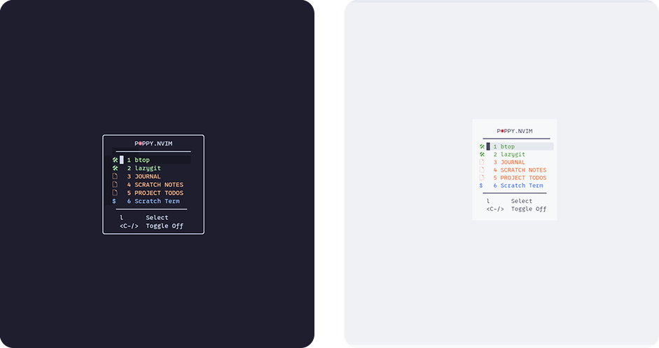
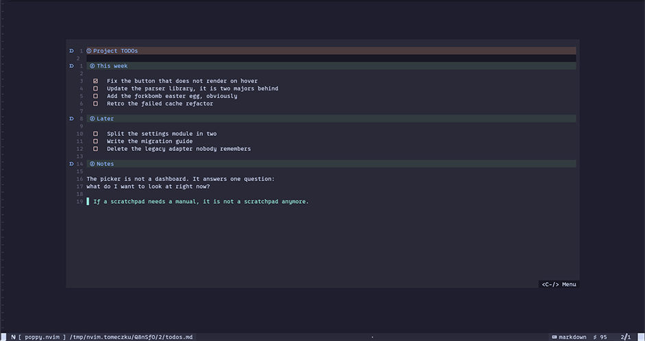
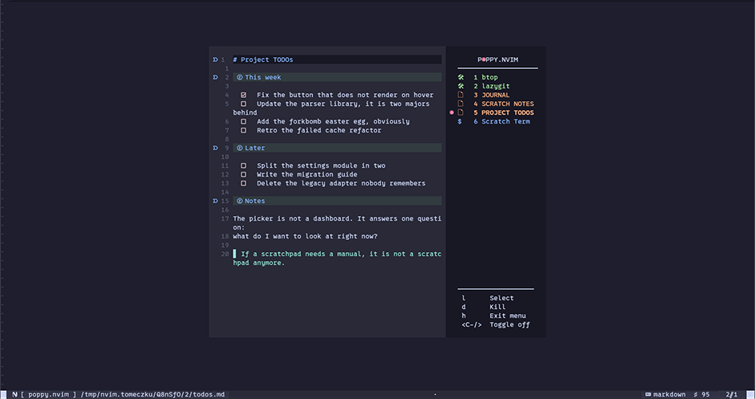
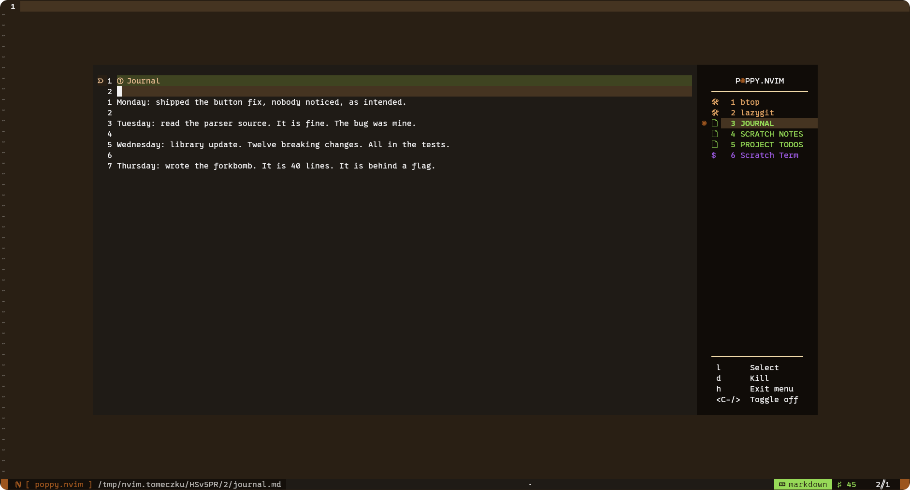
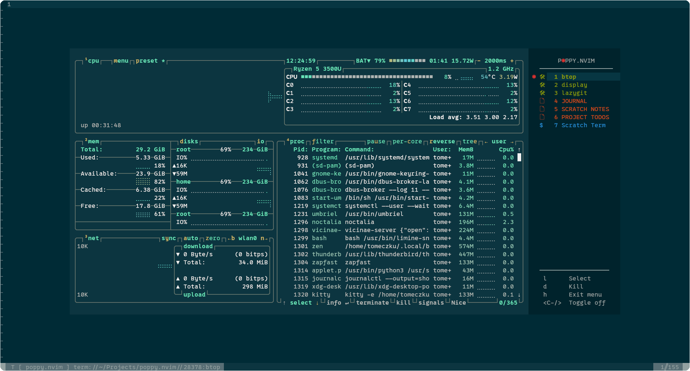
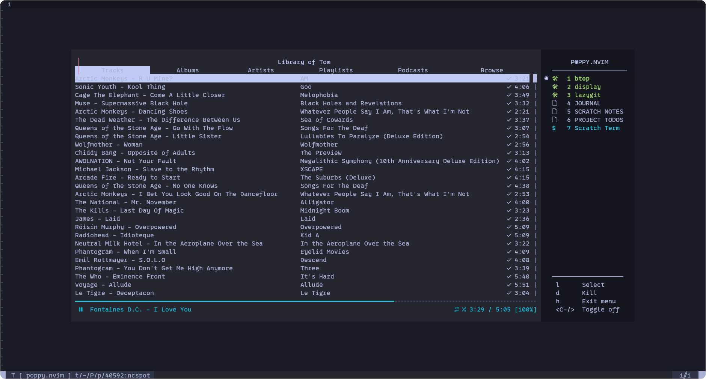
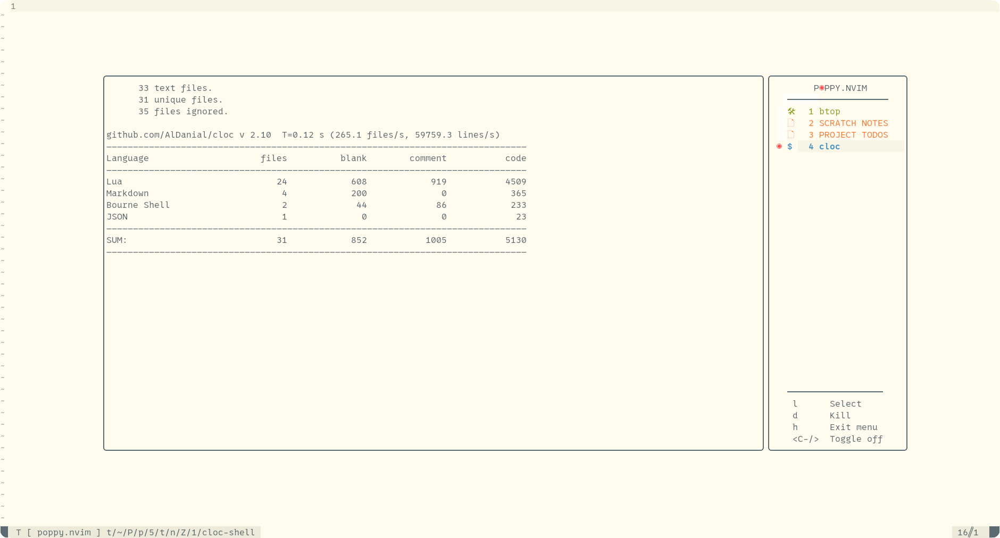
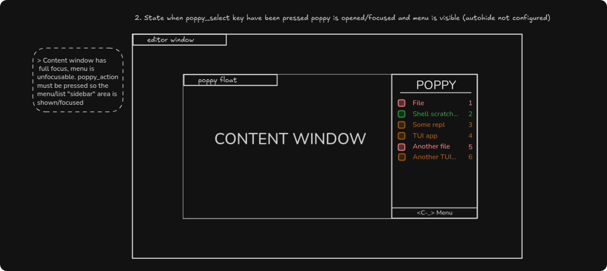

# poppy.nvim

<br> 


<br> 

> ONE POPUP FOR ALL YOUR QUICK ACCESS NEEDS IN NEOVIM

______________________________________________________________________

A neovim scratchpad popups manager. Simple setup, custom navigation, workflow and picker menu intended to feel as natural and native in neovim as possible and internal custom box of state mechanism that holds it all together.

## Screenshots:

Landing menu exmaples in light and dark cattpuccin variants. Bordered and borderless pane mode. Pick oil-style by line, or with displayed index and operator pending mode.



- Example of .md useful quickly accessible files. Total poppy ui width configurable.







- `btop` and `ncspot` tui processes examples





- Shell scratch term example



## Inspiration, motivation etc.

A bit of an extended personal introduction:

In my personal config I had for a long time some circular bindings to access important floating ui windows super-quickly. I.E:

```lua

--[[ 
    Repeatedly cycle display > enter > close lsp hovers with just K,
    not having to jump to q or do <C-w> 
]]--

vim.keymap.set("n", "<S-K>", function()
    if vim.w.lsp_floating_bufnr ~= nil or vim.w["textDocument/hover"] ~= nil then
        vim.cmd("quit")
        return
    end
    vim.lsp.buf.hover()
end, { silent = true, noremap = true })


-- Same idea but for lsp diagnostic floats

vim.keymap.set("n", "<S-L>", function()
    if vim.w.diag_float then
        vim.api.nvim_win_close(0, true)
        return
    end

    local _, win = vim.diagnostic.open_float({ focusable = true })
    if win then
        vim.api.nvim_win_set_var(win, "diag_float", true)
        return
    end
    -- dumb fallback perform a motion move
    if not vim.w.diag_float then
        vim.cmd("normal! " .. (vim.v.count > 0 and vim.v.count or 2) .. "l")
    end
end, { noremap = true, silent = true })

```

This is the flow that I like (one bind to do one thing and and hit it multiple times to change state). It is the first of the 3 sources of inspiration for the one bind-to-rule-them-all scratchpad manager.

Another significant inspiration was [SUMMON.NVIM](https://github.com/salkhalil/summon.nvim) by salhalin that briefly lived then apparently died, but I liked the idea of declaratively setting just a couple tools OR files to access in a simple unified form. What I did not like in this and practically all other plugins is you have to declare a binding for each "thingy" you setup and then remember all your bindings, or worse, find confortable binds that are still AVAILABLE in your config.

Third large inspiration were [ oil.nvim ](https://github.com/stevearc/oil.nvim/issues) and [ mini.files ](https://github.com/nvim-mini/mini.files) for just using a buffer navigated with `j/k` as sort of a picker and perform actions with simple binds acting on a *LINE*. I find it so elegant, simple and native. No mental switching buffer navigation paradigm to another. Even to "native" `<C-n> and <C-p>`, square brackets and so on I find so clunky and unified that to every supporter of "just use defaults" I want to reply "are the defaults good? If I can't do `hjkl` in vim then it is a failure of navigation design.

You can tell by now probably that the plugin is a bit opinioneted and its design is arguably a result of a bit of overthinking. However, all this is aiming to make it FEEL simple. Scratchpads are a concept that is meant to be simple and quick. If I want a heavily configured TUI swiss army knife / tank tool to do serious extended work I will just open another terminal/multiplexer pane.

Finally, my bonus "anti-inspiration" was [toggleterm.nvim](https://github.com/akinsho/toggleterm.nvim) plugin. It is an excellent established project but I had a big problem with it and existing similar solutions. In my opinion, the issue is too heavily involved sprawling config and being heavily overengineered for a plugin managing transient terminal spawns for quick access. I wanted something significantly more simple but still capable for my every day worflows.

To function `Poppy.nvim` needs as little opts as possible. Using keys and values declare how to open something and what it is i.e `exec = "btop"`, and that is it. Defaults to shipped icons and even title has a fallback detection so you can configure additional details like that, but you do not even need to.

Speaking on this sidebar selector. You might be asking:

> Why not just use pickers or vim.ui.select?

Well, the API surface is provided. For pickers there are like 5 options minimum on the market to choose from at any time, plus new custom vibecoded solutions are surely out there as well. Wire your own if you want to telescope your poppies, `PURPOSEFULLY` I am not supporting every user scenario under the sun, especially that personal code generation became so cheap and easy with AI these days.

If you read this, I thank you and salute you. More standard documentation below:

## AI Disclosure

This project has heavily relied on AI openweight models to be developed mostly in terms of writing boilerplate while under heavy direction guiding, small steps, no AGENTS doc, but rather deliberate architecture and conversation driven iteration. Beginning from `excalidraw-ed` early mocks instead of textual guides, through manual inspection and supporting agents where logic failed (especially constructing custom TUI layout for `borderless` style and custom workflow. Things like paddings, offsets from scratch with Neovim primitives, with little docs and no standards like frameworks are an area of absolute LLM failure.) To me it is both a small useful tool I needed and an exercise of finding out if a project can be developed consciously and thougthfully with the use of AI through iteration and use of human insights and knowledge rather than throwing money at a problem and letting agents run wild. On a small scale. You be the judge.



## Installation

```lua
-- vim.pack
vim.pack.add({ "https://git.tomgora.online/tomeczku/poppy.nvim" })
require("poppy").setup({
    poppies = {
        --[[
            declaring some poppy entries is required for the plugin to work
            poppy doesn't ship anything default here that might go in conflict
            with the system environment or unintentionally litter your fs with files
            If you do not do at least 1 plugin will refuse to load full logic
            and will warn you to fix your config first
        ]]--

        lazygit = { exec = "lazygit",  title = "LazyGit" },
        todos   = { file = "~/Documents/TODO.md", title = "Todos" },
        scratch = { shell = "default", title = "Terminal" },
    },
})

-- lazy.nvim
{
    "https://git.tomgora.online/tomeczku/poppy.nvim",
    lazy = false, --lazyloading built-in in internal logic
    opts = {
        poppies = {
            lazygit = { exec = "lazygit",  title = "LazyGit" },
            todos   = { file = "~/Documents/TODO.md", title = "Todos" },
            scratch = { shell = "~/.local/opt/bash-5.2/bin/bash", title = "Bash 5.2" },
        },
    },
},
```

## Configuration

```lua
-- defaults:
require("poppy").setup({
    keys = {
        poppy_action = "<C-/>",             -- remap if it doesn't work in your terminal
                                            -- or you just have a different idea for global trigger
        select       = "l",
        kill         = "d",
        exit_menu    = "h",
    },
    icons                      = { exec = "🛠", shell = "$", file = "🗋" },
                                            -- ╰- unicode as safer defaults, can be nerdfont glyphs

    autohide_menu              = false,     -- hide sidebar after selecting or after 
                                            -- period of cursor inactivity 

    title_header               = true,      -- show or hide decorative chome
    hints_footer               = true,      -- show or hide informative chome
    close_on_focus_lost        = true,      --[[ close when focus leaves poppy
                                               (cmdline, loclist, quickfix, preview, and nofile bufs 
                                               such as hovers and diagnostic floats ignored) ]]--

    close_other_floats_on_open = true,      -- close other floating windows when poppy opens
    assume_multiplexer         = false,     -- set true inside tmux/screen when 
                                            -- if defaults <C-/> not passed to nvim correctly

 -- border                     = "none"     -- "none" | "single" | "double" | "rounded" | "shadow" | border spec
     -- ╰-- doesn't have a default value set.
     --     if unset resolves dynamically with no borders style as final fallback   

    menu_width                 = 25,
    win_height                 = 0.75,      -- ratio (> 0.2 > 1.0), absolute cells (>1), or function
    win_width                  = 0.8,
    win_location               = "center",  --[[ "center" | "top" | "bottom"
                                               Horizontally always in the middle,
                                               choose if you prefer to stick to top, bottom or remain
                                               default centered depending on what region 
                                               your neck finds easier to target your eyeballs at. ]]--

    poppies = {                             -- minimal example, not defaults.
        lazygit = { exec = "lazygit" },     -- You have to declare your own
        todos   = { file = "~/.TODO.md" },
        scratch = { shell = "default" },
    },
})
```

### Poppy modes

Each defined poppy can be of the 3 following types:

| Key | Type | Behavior |
| --- | --- | --- |
| `exec` | `string\|string[]\|function` | Spawns a terminal buffer running the command. Command must be on `$PATH`. |
| `file` | `string\|function` | Opens the file at the given path. If the path does not exist when opening, a dialog asks whether to create it (and its parent directories) or drop that poppy and not use it nor display it in that session. |
| `shell` | `string\|function` | Spawns a terminal buffer with the shell. Set to `"default"` to use `$SHELL` value from the environment. |

`exec`/`file`/`shell` are validated at setup. A poppy with none is dropped; with more than one, the first (`exec`, then `file`, then `shell`) wins and poppy warns. `title` is optional and defaults to the file basename or command name.

### Borders

`border` takes `"none"`, `"single"`, `"double"`, `"rounded"`, `"shadow"`, or a border table of chars. `"none"` and `"solid"` fold into premade poppy's borderless custom design. It uses both none and solid borders on the ui windows to create looks and paddings. If `border` is not set poppy attempts to falls back to `vim.opt.winborder` first, finally it will use this borderless style as default.

> NOTE: Currently I haven't decided how to solve and render "shadow" border style properly. Due to a non-typical use of cells and colors by this style it does not render quite as nice and regular "line-based" borders or custom "borderless style".

### Key bindings

`keys.poppy_action` is the one binding you press constantly, so it deserves a moment of attention. Inside tmux or screen, some terminals drop `<C-/>` (or any Ctrl combination whose underlying byte is consumed by the multiplexer) before it reaches nvim — the keymap is bound but never fires. If that happens to you, either:

- bind a key your terminal forwards cleanly (`<C-_>`, `<C-\>`, etc.), or
- set `assume_multiplexer = true` and poppy will rebind `<C-/>` to `<C-_>` automatically when `$TMUX`/`$STY` are set.

On modern terminals (kitty, wezterm, foot with `extkeys`, ghostty) inside tmux, `<C-/>` usually works as-is — `assume_multiplexer` is only needed when it doesn't.

### Dialogs

Two questions can interrupt a workflow of the plugin. Intention was to keep the plugin as quiet and able to operate based just on declared configuration. The missing file case displays before the UI settles, forcing you to make a decision, so the plugin operates on correct state and does not offer you opening a file that does not exist.

- **Missing file** — a `file` poppy points at a path that does not exist. `Yes` creates it along with its parent directories, `No` drops that poppy and it is not available from menu throughout this session.
- **Unsaved changes** — When attempting to kill a file poppy whose buffer is modified. `Save` writes it, `Discard` drops the changes, `Go back` cancels the kill and returns to normal operation. Only applies to declared text file poppies.

### Unsaved edits and missing files

Buffers stay loaded in the background when you switch between poppies, or toggle the ui off (`bufhidden = "hide"`). Your work persists until you intentionally close the file/process from within a poppy buffer, or use a kill shortcut on the poppy.

## Usage

`keys.poppy_action` opens the manager's "landing view" picker if no poppies ; press it again to toggle off. If you have running poppies it will, open with the last active poppy window focused for work already, press again to focus the menu in a "sidebar" form, then the third press will cycle back to the "toggled off" state. From the sidebar: `select` switches the running visible poppy content, `kill` terminates a running instance of poppy, `exit_menu` returns focus to the content pane. The big red dot indicates the currently running and focused poppy. If there are running unfocused instances they are marked with a small subtler dot in the signcolumn of the picker window.

```
:Poppy                 " toggle
:Poppy close           " close
:Poppy menu            " toggle the sidebar only
:Poppy open [<name>]   " open, or switch to <name> if already open.
    NOTE: Plain open with no name passed will act like toggle on action,
    opening "landing" picker or recently active poppy
```

In cmdline the tab-completion knows the configured poppy names.

Poppy refuses to open in a terminal smaller than 57×12 cells and says so; size the window up and toggle it back on.

## Lua API

```lua
require("poppy").setup({ ... })

require("poppy").open(name?)
require("poppy").close()
require("poppy").toggle()

require("poppy").switch_by_name(name)
require("poppy").switch_by_index(int)
require("poppy").switch_by_cursor()

require("poppy").kill_active()
require("poppy").kill_by_name(name)
require("poppy").kill_by_index(int)
require("poppy").kill_by_cursor()

require("poppy").get_poppies()
require("poppy").get_poppy_by_name(name)
require("poppy").get_poppy_by_index(int)
require("poppy").get_current_poppy()
require("poppy").get_current_poppy_name()
require("poppy").is_open()
```

`toggle()` soft-hides the UI: the session's buffers stay alive, so reopening restores your last poppy. `close()` is the full teardown — buffers and runtimes are dropped, so the next `open()` lands on the picker.

`setup` may be re-called; a second call tears down any live session before re-initializing.

`kill_by_name` / `kill_by_index` act on a poppy that has been opened. A configured but never-opened poppy has no session to kill and is left alone.

## How it works

From bird's eye view it is all just lua table holding state-in-memory during a running neovim session, loaded when plugin is first interacted with. Poppy does not store nor persist any state and will not be restored when native session restoration starts your neovim back up. This is intentional as plugin is meant as a transient tool, for quick access to important files and tools and maybe look nice and operate easy. Everything beyond that is considered and intentionally placed on the "excess feature creep" shelf.

## License

Public domain; see [UNLICENSE](./UNLICENSE).

